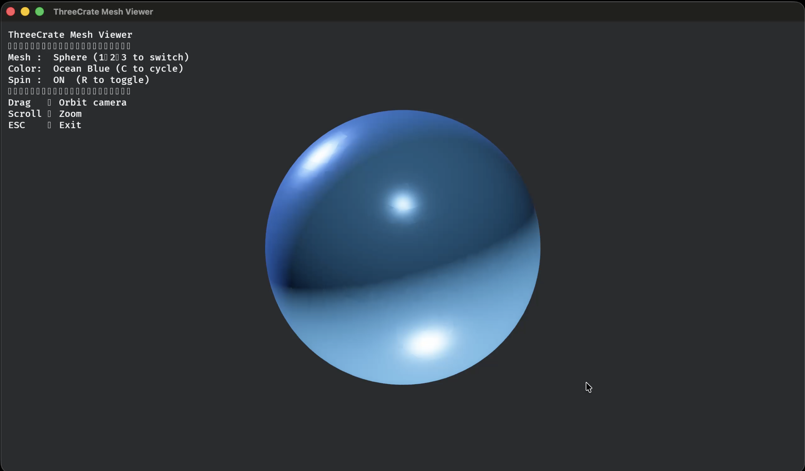

<p>
  
</p>

# threecrate

[](https://crates.io/crates/threecrate)
[](https://pypi.org/project/threecrate/)
[](https://docs.rs/threecrate)
[](https://github.com/rajgandhi1/threecrate/actions)
[](LICENSE)

Fast 3D point cloud and mesh processing in Rust and Python, with an agent skill that lets Claude Code, Codex, Gemini CLI and others work on your scans.

Ask your agent to "make my scan printable" and it cleans the scan, closes the holes, adds a base, checks the result with a picture and saves an STL. No Blender, no MeshLab, no guessing at parameters.

## Installation (30-second setup)

### 1. Get the skill

<details>
<summary><strong>Claude Code</strong></summary>

```bash
claude plugin marketplace add rajgandhi1/threecrate
claude plugin install threecrate@threecrate
```

Or type `/plugin marketplace add rajgandhi1/threecrate`, then `/plugin install threecrate@threecrate`, as two prompts.

</details>

<details>
<summary><strong>Codex</strong></summary>

```bash
codex plugin marketplace add rajgandhi1/threecrate
codex plugin add threecrate@threecrate
```

Start a new thread after installing.

</details>

<details>
<summary><strong>Gemini CLI</strong></summary>

```bash
gemini extensions install https://github.com/rajgandhi1/threecrate
```

</details>

<details>
<summary><strong>OpenCode, Cursor or any other agent</strong></summary>

Copy the `skills/threecrate` folder into your agent's skills folder. [INSTALL.md](INSTALL.md) has the exact commands for each agent.

</details>

<details>
<summary><strong>Any MCP client</strong> (instead of the skill)</summary>

```bash
claude mcp add threecrate -- uvx threecrate-mcp
```

[threecrate-mcp](threecrate-mcp/README.md) gives the agent tools such as `inspect_mesh`, `repair_for_print` and `render`, which hands it a picture of the result.

</details>

The skill needs `python` 3.8 or newer on your PATH. The agent installs `threecrate` into a virtual environment the first time.

### 2. Ask in plain words

- "Make table_scan.ply printable."
- "Is part.stl ready to print?"
- "Clean up this scan and drop the floor."
- "Align these two scans."
- "How tall is the pole in street.pcd?"

### 3. That's it

Want to try it first? [samples/](samples/README.md) has small scans with known answers, and [the demo](samples/DEMO.md) shows a full run.

## Why threecrate

### #1: Scans don't print

**The problem.** A phone or LiDAR scan comes out with stray points, the table it stood on, holes, no base and flipped faces. The slicer rejects it, and fixing it means learning MeshLab or Blender.

**The fix.** `repair_for_print` takes a point cloud or a mesh and returns a watertight STL, with a report of every step. `analyze_mesh` tells you what is wrong before you start.

### #2: Agents can't see 3D

**The problem.** An agent can run a mesh tool, but it can't tell whether the result looks right. It reports success on a blob.

**The fix.** `render` draws any cloud or mesh from five views into one PNG, with no GPU. Holes and inside-out faces show orange. The skill makes the agent look at the before and after picture before it reports.

### #3: Parameters are guesswork

**The problem.** Every voxel size, radius and threshold depends on the scan's units and density. Wrong values delete real points or do nothing.

**The fix.** The skill inspects each scan first and sizes every parameter from its point spacing. One guide per task keeps the agent on a known path: [clean](skills/threecrate/guides/clean-scan.md), [align](skills/threecrate/guides/align-scans.md), [make printable](skills/threecrate/guides/make-printable.md), [measure](skills/threecrate/guides/measure.md).

### #4: 3D libraries are slow or heavy

**The problem.** Open3D and PCL are large C++ builds. Pure Python is too slow for millions of points.

**The fix.** threecrate is Rust with a `pip install`. It is 1.5x to 3.4x faster than Open3D on reading, downsampling, normals and ICP across TUM, KITTI and nuScenes frames, with the same ICP accuracy (measured on Windows; in a Linux container the two are close). GPU code runs on any card through wgpu. Full numbers in [docs/benchmarks.md](docs/benchmarks.md).

## Reference

### Python

```bash
pip install threecrate
```

```python
import threecrate as tc

scan = tc.read_point_cloud("scan.ply")  # or tc.read_mesh("part.stl")
mesh, report = tc.repair_for_print(scan, remove_floor=True)
print(report["steps"], report["after"]["printable"])
tc.render([scan, mesh], "before_after.png")  # orange shows holes and inside-out faces
tc.write_mesh(mesh, "part.printable.stl")
```

All functions: [Python API reference](threecrate-python/README.md).

### Rust

```toml
[dependencies]
threecrate = "0.12.1"
```

```rust
use threecrate::prelude::*;

let cloud = read_point_cloud("scan.ply")?;
let cloud = voxel_grid_filter(&cloud, 0.05)?;
let normals = estimate_normals(&cloud, 10)?;
let mesh = auto_reconstruct(&normals)?;
write_mesh("output.obj", &mesh)?;
```

<details>
<summary><strong>Crates</strong></summary>

| Crate | What it does |
|---|---|
| `threecrate-core` | Point, PointCloud, TriangleMesh, Transform3D, mesh health checks |
| `threecrate-algorithms` | Filtering, ICP, NDT, global registration, segmentation, normals, FPFH/SHOT, mesh boolean, smoothing |
| `threecrate-gpu` | GPU filtering, segmentation, ICP, normals, nearest-neighbor, TSDF, real-time rendering (wgpu) |
| `threecrate-io` | PLY, OBJ, STL, PCD, XYZ/CSV, LAS/LAZ\*, E57\*, streaming and memory-mapped; PNG previews without a GPU |
| `threecrate-reconstruction` | Poisson, ball pivoting, alpha shapes, Delaunay, marching cubes, MLS, auto-select, repair for 3D printing |
| `threecrate-simplification` | Quadric error, edge collapse, clustering, progressive mesh |
| `threecrate-visualization` | Interactive viewer: orbit, pan, zoom, GPU-accelerated |

\* opt-in feature flags. See [installation and feature flags](docs/installation.md).

</details>

<details>
<summary><strong>Compared with Open3D and PCL</strong></summary>

| Feature | threecrate | Open3D | PCL |
|---|---|---|---|
| Language | Rust + Python | Python (C++ core) | C++ |
| `pip install` | ✅ | ✅ | ❌ |
| Memory safety | ✅ Rust | ❌ | ❌ |
| GPU compute | ✅ wgpu, any GPU | ✅ CUDA | Partial |
| Global registration | ✅ FPFH + RANSAC | ✅ | ✅ |
| Surface reconstruction | ✅ 6 algorithms | ✅ | ✅ |
| Repair for 3D printing | ✅ one call | Partial | ❌ |
| Agent skill and MCP server | ✅ | ❌ | ❌ |
| Streaming I/O | ✅ PLY/OBJ/XYZ | ❌ | ❌ |
| E57 support | ✅ opt-in | ❌ | ❌ |

</details>

<details>
<summary><strong>Viewer</strong></summary>



</details>

### Docs

- [Crate reference](docs/crates.md)
- [Examples](docs/examples.md)
- [Benchmarks](docs/benchmarks.md)
- [API docs on docs.rs](https://docs.rs/threecrate)

## Contributing

Contributions are welcome: algorithms, Python bindings, new formats, docs.

- [ROADMAP.md](ROADMAP.md): where we're ahead, where we trail, and what's next
- [CONTRIBUTING.md](CONTRIBUTING.md): setup and guidelines
- [Open issues](https://github.com/rajgandhi1/threecrate/issues): look for `good first issue`
- [GitHub Discussions](https://github.com/rajgandhi1/threecrate/discussions): questions and ideas

## License

MIT OR Apache-2.0.
